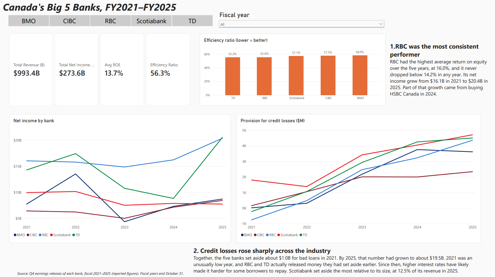
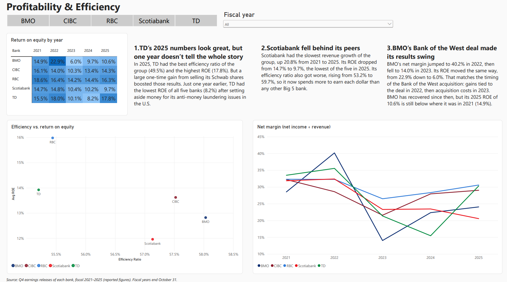
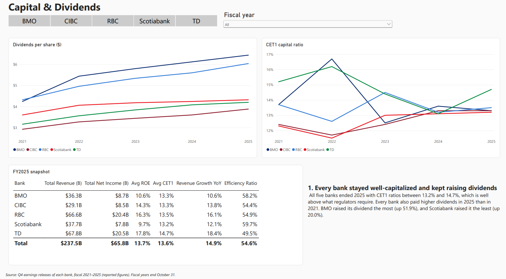

# Canadian Big 5 Banks Financial Dashboard

An interactive Power BI dashboard comparing Canada's five largest banks (RBC, TD, Scotiabank, BMO and CIBC) on profitability, efficiency, credit losses and capital over fiscal 2021–2025.

## Tools used

- **Power BI Desktop**: dashboard design and interactivity
- **DAX**: calculated measures (efficiency ratio, net margin, year-over-year growth)
- **Power Query**: data import and cleaning
- **Excel**: data collection and organization

## What's in the dashboard

| Page | What it shows |
|---|---|
| Overview | Revenue, net income, ROE and efficiency ratio cards; net income and credit loss trends; efficiency ratio by bank |
| Profitability & Efficiency | ROE heatmap by bank and year; efficiency vs. ROE scatter chart; net margin trends |
| Capital & Dividends | CET1 capital ratio trends; dividends per share; FY2025 snapshot table |

Slicers let you filter every page by bank and fiscal year.

## Key findings

**1. RBC was the most consistent performer.**
RBC had the highest average return on equity over the five years, at 16.0%, and it never dropped below 14.2% in any year. Its net income grew from $16.1B in 2021 to $20.4B in 2025. Part of that growth came from buying HSBC Canada in 2024.

**2. TD's 2025 numbers look great, but one year doesn't tell the whole story.**
In 2025, TD had the best efficiency ratio of the group (49.5%) and the highest ROE (17.8%). But a large one-time gain from selling its Schwab shares boosted those results. Just one year earlier, TD had the lowest ROE of all five banks (8.2%) after setting aside money for its U.S. anti-money laundering issues.

**3. Credit losses rose sharply across the industry.**
Together, the five banks set aside about $1.0B for bad loans in 2021. By 2025, that number had grown to about $19.5B. 2021 was an unusually low year, and RBC and TD actually released money they had set aside earlier. Since then, higher interest rates have likely made it harder for some borrowers to repay. Scotiabank set aside the most relative to its size, at 12.5% of its revenue in 2025.

**4. Scotiabank fell behind its peers.**
Scotiabank had the slowest revenue growth of the group, up 20.8% from 2021 to 2025. Its ROE dropped from 14.7% to 9.7%, the lowest of the five in 2025. Its efficiency ratio also got worse, rising from 53.2% to 59.7%.

**5. BMO's Bank of the West deal made its results swing.**
BMO's net margin jumped to 40.2% in 2022, then fell to 14.0% in 2023. Its ROE moved the same way, from 22.9% down to 6.0%. That matches the timing of the Bank of the West acquisition: gains tied to the deal in 2022, then acquisition costs in 2023. BMO has recovered since, but its 2025 ROE of 10.6% is still below 2021's 14.9%.

**6. Every bank stayed well-capitalized and kept raising dividends.**
All five banks ended 2025 with CET1 ratios between 13.2% and 14.7%, well above what regulators require. Every bank paid higher dividends in 2025 than in 2021. BMO raised its dividend the most (up 51.9%), and Scotiabank the least (up 20.0%).

## Key terms

- **Efficiency ratio**: non-interest expenses ÷ revenue. Lower means the bank spends less to earn each dollar.
- **ROE (return on equity)**: net income ÷ shareholders' equity. Shows how much profit the bank makes on its owners' money.
- **PCL (provision for credit losses)**: money set aside for loans that may not be repaid.
- **CET1 ratio**: core capital ÷ risk-weighted assets. A measure of how strong a bank's safety cushion is.

## Data

- **Source:** each bank's Q4 earnings release for fiscal 2021–2025. All figures are **reported** (not adjusted) and in Canadian dollars. Each row in the Excel file lists the exact release it came from.
- **Fiscal years** end October 31 for all five banks, so years line up directly.
- **Accounting note:** Canadian banks adopted IFRS 17 (insurance accounting) in fiscal 2024, so FY2021–2023 and FY2024–2025 are not perfectly comparable.
- CIBC's 2021 EPS and dividends are adjusted for its 2022 two-for-one stock split.

## Files

| File | Description |
|---|---|
| `Big5_Banks_Dashboard.pbix` | The Power BI report (open with Power BI Desktop, free) |
| `Big5_Banks_Dashboard.pdf` | PDF export of all dashboard pages |
| `data/Canadian_Big5_Banks_FY2021-2025.xlsx` | The dataset, with definitions, sources and notes |
| `screenshots/` | Images of each dashboard page |

## Author

**Jabeer Rahman**, BBA Co-op (Management and Accounting), University of Toronto Scarborough
